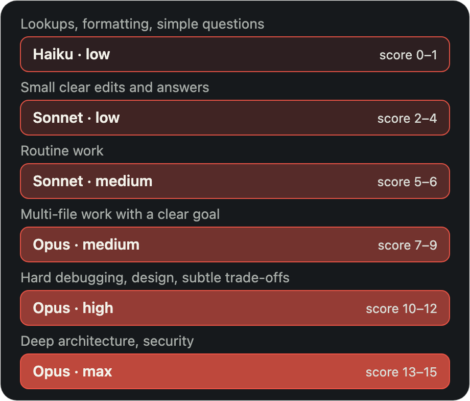

# Prompt Master

**Rough prompt in, clear prompt out, plus the right model and effort level to run it.**

Type `pm:` before a rough prompt and Prompt Master rewrites it, shows you the rewrite, and answers it. Type `ep:` before a task and it recommends a model and effort level without doing the task.

## See it work

You type:

```text
pm: help me write a message asking my landlord to fix the heater
```

It rewrites your prompt:

> Write a short message to my landlord asking them to fix the heater in my apartment. Describe the problem ([what the heater is doing]) and since when ([date]), and ask when someone can come take a look. End with the times I'm home ([times]).

Then it answers that clearer prompt. Details you didn't give become `[placeholders]` instead of guesses.

## Commands

| You type | You get |
| --- | --- |
| `pm: <rough prompt>` | A rewritten prompt, then the answer to it |
| `pm only: <rough prompt>` | Only the rewritten prompt, in a copy-ready block |
| `pm pick: <rough prompt>` | The rewrite, then a model and effort recommendation for it |
| `ep: <task>` | A model and effort recommendation for the task as you wrote it |
| `ep claude: <task>` | The same, plus a short Claude Code plan, plan mode and subagent advice |
| `pm code:` `pm email:` `pm study:` `pm research:` | A preset that shapes the rewrite for that kind of task |
| `pm critique: <rough prompt>` | A score out of 10, what's missing, and the one fix to make first |
| `pm why` · `pm again` · `pm undo` | Explain the last rewrite, redo it, or answer your original draft as typed |
| `pm help` | Every command, with examples |

## Which model it picks

The picker scores how hard, broad, risky and vague the task is, and only recommends the top models when the score earns them. Each bar shows the score range for that model.



## What it contains

This plugin contains one skill, `skills/prompt-master/SKILL.md`. It is a set of instructions only: it has no scripts, hooks or MCP servers, and it doesn't fetch or send anything. The two images on this page are bundled with the plugin.

## Privacy

Prompt Master doesn't collect, store or send any data. It works only on the text you type in the chat. Full details: [PRIVACY.md](PRIVACY.md).

## More

Full documentation, other install options and a ChatGPT and Codex edition: https://github.com/nishkarsh-shah/prompt-master

MIT licensed.
